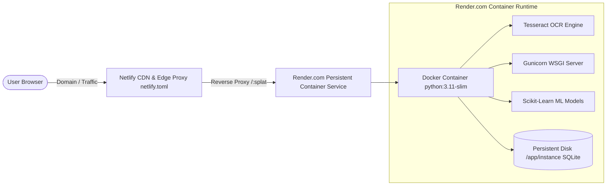

# 🌐 ExpenseShare AI — Cloud Deployment & Hosting Architecture Guide

This guide provides complete instructions for deploying the **ExpenseShare AI** platform to the cloud, explaining why Netlify requires a persistent backend service and providing ready-to-run configurations for automatic deployment.

---

## 🏛️ 1. Architecture & Platform Compatibility Analysis

### **Can ExpenseShare AI run 100% directly inside Netlify?**
**No, and here is why:**
1. **Persistent SQLite Database (`instance/expenseshare.db`)**:
   Netlify Functions are serverless (ephemeral AWS Lambda containers) with a read-only filesystem (except `/tmp`). Any user signups, expenses logged, settlements recorded, or OCR uploads written to SQLite would be immediately wiped whenever a Lambda container recycles or spins down.
2. **Native OCR Binaries (`tesseract-ocr`)**:
   The receipt OCR pipeline requires the native Linux C++ `tesseract-ocr` binary and language training data (`/usr/share/tesseract-ocr/4.00/tessdata`). Netlify functions do not permit `apt-get` or custom system packages.
3. **Heavy Machine Learning Libraries**:
   The category prediction and statistical engines depend on `scikit-learn`, `scipy` (37MB), `numpy`, and `pandas`. These dependencies exceed serverless function memory and cold-start execution constraints.
4. **Monolithic Server-Side Jinja2 Architecture**:
   ExpenseShare AI is built with Flask blueprints using server-rendered HTML templates with session-based authentication (`Flask-Login`), requiring a long-running WSGI/ASGI web server process (`gunicorn`).

---

## 🚀 2. The Production Deployment Architecture

To achieve a reliable, scalable, and cost-effective deployment with Netlify:



1. **Backend Service (Render.com / Railway / Fly.io)**:
   Runs our multi-stage `Dockerfile` with native Tesseract OCR, Python 3.11, Gunicorn, Scikit-Learn models, and a 1GB **Persistent Disk** mounted at `/app/instance` to keep the SQLite database completely safe and permanent across deploys.
2. **Frontend Entrypoint (Netlify)**:
   Netlify serves as the custom domain, SSL layer, and CDN edge proxy via `netlify.toml`, seamlessly forwarding all web requests to the container backend.

---

## 📋 3. Step-by-Step Deployment Instructions

### **Step 1: Backend Deployment on Render (2 Minutes)**

1. Sign up or log in at **[render.com](https://render.com)** (Free tier available).
2. Go to your **Render Dashboard** and click **New +** ➡️ **Blueprint**.
3. Connect your GitHub repository:
   ```
   https://github.com/vignesh-developer6766/Expense-Share
   ```
4. Render automatically detects the [`render.yaml`](../render.yaml) file in the repository root.
5. Click **Apply**.
6. Render will:
   - Build the Docker container (`tesseract-ocr`, python dependencies, ML models).
   - Mount the 1GB persistent disk for `expenseshare.db`.
   - Run `python scripts/init_db.py` to seed initial admin & sample data.
   - Start Gunicorn on `0.0.0.0:$PORT`.
   - Assign you a public HTTPS URL (e.g., `https://expenseshare-ai.onrender.com`).

---

### **Step 2: Connect Netlify (1 Minute)**

1. Log in to **[netlify.com](https://app.netlify.com)**.
2. Click **Add new site** ➡️ **Import an existing project** ➡️ Select **GitHub**.
3. Choose the repository: `vignesh-developer6766/Expense-Share`.
4. Netlify will read [`netlify.toml`](../netlify.toml).
5. Update `to = "https://<your-render-url>.onrender.com/:splat"` in `netlify.toml` with your actual Render URL and push to GitHub, or add an environment variable in Netlify.
6. Click **Deploy Site**. Netlify will provide your live Netlify domain (e.g. `https://expenseshare-ai.netlify.app`).

---

## 🔒 4. Production Environment Variables Reference

| Variable | Recommended Value | Description |
| :--- | :--- | :--- |
| `FLASK_ENV` | `production` | Enables production mode & security optimizations |
| `SECRET_KEY` | *(Render auto-generates this)* | Cryptographic key for session cookies & CSRF |
| `DATABASE_URL` | `sqlite:////app/instance/expenseshare.db` | Points to the persistent mounted disk volume |
| `PYTHONUNBUFFERED` | `1` | Ensures real-time container log output |
| `PORT` | `5000` *(or Render dynamic port)* | Port exposed to web traffic |

---

## ✅ 5. Post-Deployment Verification Checklist

Once deployed, verify the following core features:
- [ ] **Authentication**: Log in with demo admin credentials (`vignesh@example.com` / `Password123`).
- [ ] **Multi-Split Engine**: Create an expense with Equal, Exact, Percentage, and Shares splits.
- [ ] **Receipt OCR**: Upload a receipt bill image under `/ocr/` to verify Tesseract extraction.
- [ ] **Nexus.AI Assistant**: Visit `/ai` and test ChatGPT-style queries (*"I paid ₹1200 for lunch"*).
- [ ] **Debt Simplification**: Check `/groups/1/settlements` to verify greedy balance reduction.
- [ ] **Admin Security**: Verify that only `vignesh@example.com` has permissions to edit/delete user accounts in `/users`.
