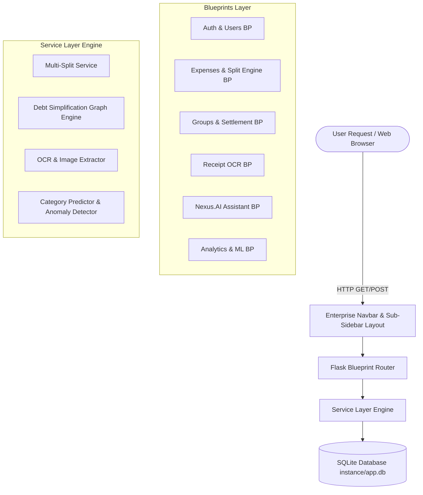
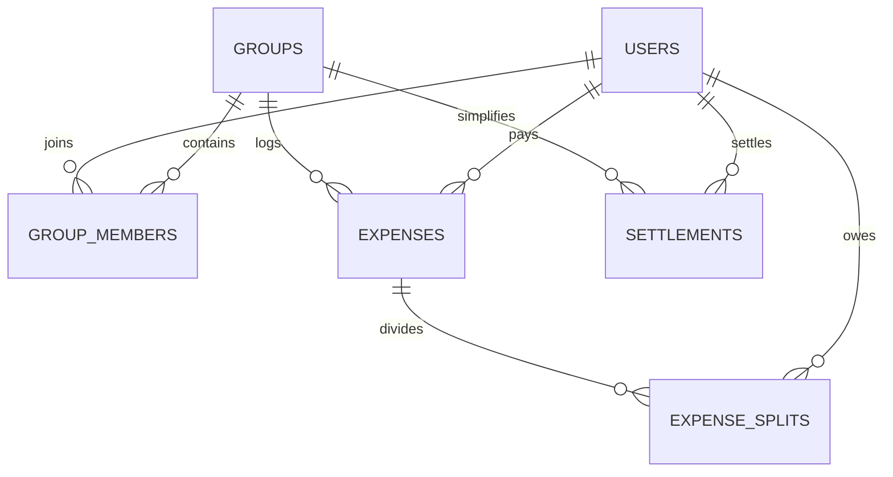

# 🚀 ExpenseShare AI — Full Technical Documentation & Architecture Guide

## 📌 Executive Summary
**ExpenseShare AI** is an Enterprise SaaS-grade, AI-powered shared expense management and financial intelligence platform built with Python (Flask 3.x), SQLite, Bootstrap 5, Chart.js, and Machine Learning algorithms.

The application allows roommates, travel groups, and teams to automate bill splits across 4 calculation engines (*Equal*, *Exact*, *Percentage*, *Shares*), minimize inter-member debt chains using a greedy graph simplification algorithm, scan receipt bills via Optical Character Recognition (OCR), interact with a ChatGPT-style conversational assistant (**Nexus.AI**), and visualize 6-month spending trends and anomalies.

---

## 🛠️ 1. Complete Tech Stack & Component Breakdown

### **Backend Framework & Language**
- **Python 3.14**: Main programming language for application logic, algorithms, ML pipelines, and API services.
- **Flask 3.x**: Micro web framework utilizing the **Application Factory pattern** (`create_app()`) and **Modular Blueprints** (`auth`, `dashboard`, `expenses`, `groups`, `settlements`, `analytics`, `ai`, `ocr`, `users`, `recurring`, `notifications`, `api`).
- **Flask-Login**: Manages user authentication sessions, remember-me cookies, and route access protection (`@login_required`).
- **Flask-WTF & WTForms**: Form rendering, validation, and Cross-Site Request Forgery (CSRF) protection.
- **Flask-SQLAlchemy**: Object-Relational Mapping (ORM) layer mapping database tables to Python objects.
- **Flask-Migrate / Alembic**: Handles relational database migrations and versioning.

### **Database Layer**
- **SQLite 3 (`instance/app.db`)**: Lightweight, file-based relational database storing users, groups, memberships, expenses, splits, settlements, recurring bills, and notifications.

### **Frontend & UI System**
- **HTML5 & Jinja2 Template Engine**: Server-rendered templates with clean component inheritance (`base.html`, `_sidebar.html`, `_stat_card.html`, `_empty_state.html`).
- **Bootstrap 5.3**: Grid system, responsive utility classes, flex layouts, form elements, and modal overlays.
- **Bootstrap Icons (v1.11+)**: Vector icons representing categories, navigation items, and action states.
- **Chart.js**: Client-side charting library rendering interactive 6-month spending trend bar charts (`type: 'bar'`) and category distribution doughnut/pie charts.
- **Custom Design System (`static/css/app.css`)**: Modeled after the **ExpenseIn Enterprise SaaS Layout**, featuring a Dark Charcoal Slate top header navbar (`#1A202C`), crisp white sub-sidebar (`#FFFFFF`) with red active indicator bar (`#EF4444`), and Coral Crimson Red primary buttons (`#EF4444`).

### **AI, ML & Optical Character Recognition (OCR)**
- **Pytesseract / PIL Image Enhancement**: Image contrast enhancement (`ImageEnhance.Contrast`) and Tesseract OCR engine for text extraction from receipt uploads (`text_extractor.py`).
- **Scikit-Learn (TF-IDF & Naive Bayes)**: TF-IDF vectorizer and Naive Bayes classifier trained to predict expense categories (*Food*, *Groceries*, *Transport*, *Shopping*, *Utilities*, *Entertainment*, *Travel*, *Rent*) from descriptions and receipt text (`predict_category.py`).
- **Domain Heuristic Fallback**: High-confidence keyword rule engine for retail vendors (`DMart`, `Zomato`, `Uber`, `Reliance Digital`, `Amazon`, etc.).
- **Statistical Anomaly & Forecasting**: Z-score statistical outlier detection (`anomaly_detector.py`) and 3-month rolling moving average forecasting (`forecasting.py`).
- **NLP Natural Language Expense Parser**: Regex and rule-based parser transforming natural language inputs (e.g. *"I paid ₹1200 for dinner with Alex"*) into structured expense entries (`expense_parser.py`).

### **Testing & Automation**
- **Pytest 9.x**: Full unit testing framework covering routes, models, split calculations, debt simplification, OCR, and user CRUD operations (**50 / 50 passing unit tests**).
- **Playwright**: End-to-end browser testing script (`take_screenshots.py`) capturing responsive screenshots across desktop, tablet, and mobile views.

---

## 🏗️ 2. System Architecture & High-Level Data Flow



---

## ⚙️ 3. Core Modules & How They Work

### 🔑 1. Authentication & User Management (`/auth` & `/users`)
- **Authentication**: Users log in with email and password. Passwords are securely hashed using Werkzeug's `generate_password_hash` algorithm.
- **User Management**: Admins and users can view the registered accounts table, see individual group/expense stats, edit account details, and delete users (`/users`).

### 📐 2. Multi-Split Calculation Engine (`app/services/split_service.py`)
Supports 4 distinct expense splitting methods:
1. **Equal Split**: Divides the total cost equally among selected members ($Amount / N$).
2. **Exact Amounts**: Accepts exact custom currency amounts per member ($\sum \text{Exact}_i = \text{Total}$).
3. **Percentage Split**: Computes shares based on custom percentages ($\sum \%_i = 100\%$).
4. **Shares Split**: Computes ratios based on assigned weights ($\text{Share}_i = \text{Total} \times \frac{\text{Weight}_i}{\sum \text{Weights}}$).

### 🔄 3. Debt Simplification Algorithm (`app/services/balance_service.py`)
Prevents complex webs of mutual debts within groups using a **Greedy Net-Balance Minimizer**:
1. Computes net balance ($Net_i = \text{Paid}_i - \text{Owed}_i$) for every member.
2. Separates members into **Debtors** ($Net < 0$) and **Creditors** ($Net > 0$).
3. Sorts Debtors ascending and Creditors descending.
4. Greedily matches the largest debtor with the largest creditor, reducing up to $N \times (N-1)$ individual debts down to a minimum set of $N-1$ simplified settlements.

### 📷 4. Receipt OCR Processing Pipeline (`app/ocr/receipt_processor.py`)
1. User uploads a receipt photo (PNG, JPG, WEBP).
2. `TextExtractor` preprocesses the image using PIL grayscale and 2.0x contrast enhancement.
3. Tesseract OCR extracts raw text.
4. Regex rules filter noise headers (`TAX INVOICE`, `GSTIN`, `DATE`) to identify the store vendor and extract total amounts (handling commas like `₹1,450.00` or `Rs. 450/-`).
5. ML Category Predictor assigns category predictions (*Food*, *Groceries*, *Transport*, *Shopping*, etc.).

### 🤖 5. Nexus.AI Conversational Assistant (`app/ai/assistant.py` & `/ai`)
- A **ChatGPT-style financial AI assistant** accepting natural language questions or expense commands.
- **Intent Classifier**:
  - *Expense Logging Intent*: Parses commands like *"I paid ₹1200 for dinner with Alex"* and outputs an interactive **Confirm & Log Expense** card.
  - *Debt Inquiries*: Queries `BalanceService` to report live net balances (*"Who owes me money?"*).
  - *Analytics Inquiries*: Queries `AnalyticsService` for top spending categories and monthly trends.
  - *Budgeting Advice*: Explains financial strategies (e.g. 50/30/20 rule, debt simplification tips).

---

## 🗄️ 4. Database Schema Architecture



### Table Definitions:
- **`users`**: `id`, `name`, `email`, `password_hash`, `created_at`
- **`groups`**: `id`, `name`, `description`, `created_by`, `created_at`
- **`group_members`**: `id`, `group_id`, `user_id`, `joined_at`
- **`expenses`**: `id`, `group_id`, `paid_by`, `description`, `amount`, `category`, `split_type`, `expense_date`
- **`expense_splits`**: `id`, `expense_id`, `user_id`, `amount`, `percentage`, `shares`
- **`settlements`**: `id`, `group_id`, `payer_id`, `receiver_id`, `amount`, `status`, `settlement_date`
- **`recurring_expenses`**: `id`, `group_id`, `description`, `amount`, `frequency`, `next_due_date`, `category`
- **`notifications`**: `id`, `user_id`, `title`, `message`, `is_read`, `created_at`

---

## 📁 5. Codebase Directory Sitemap

```
Expense sharing/
├── app/
│   ├── __init__.py          # Flask Application Factory & Jinja Context Setup
│   ├── config.py            # Environment configurations (Dev, Testing, Prod)
│   ├── extensions.py        # SQLAlchemy, Migrate, LoginManager, CSRF instances
│   ├── ai/                  # Nexus.AI Assistant & NLP Expense Parser
│   │   ├── assistant.py
│   │   ├── expense_parser.py
│   │   └── prompts.py
│   ├── ml/                  # Machine Learning Classifiers & Statistical Analyzers
│   │   ├── predict_category.py
│   │   ├── anomaly_detector.py
│   │   ├── duplicate_detector.py
│   │   └── forecasting.py
│   ├── models/              # Relational Database ORM Models
│   │   ├── user.py
│   │   ├── group.py
│   │   ├── expense.py
│   │   ├── settlement.py
│   │   ├── recurring_expense.py
│   │   └── notification.py
│   ├── ocr/                 # OCR Image Extraction & Receipt Processor
│   │   ├── receipt_processor.py
│   │   └── text_extractor.py
│   ├── routes/              # Controller Blueprints
│   │   ├── auth.py
│   │   ├── dashboard.py
│   │   ├── expenses.py
│   │   ├── groups.py
│   │   ├── settlements.py
│   │   ├── analytics.py
│   │   ├── ai_routes.py
│   │   ├── ocr_routes.py
│   │   ├── users.py
│   │   ├── recurring.py
│   │   └── notifications.py
│   ├── services/            # Business Logic & Math Calculators
│   │   ├── split_service.py
│   │   ├── balance_service.py
│   │   ├── group_service.py
│   │   ├── expense_service.py
│   │   ├── analytics_service.py
│   │   └── settlement_service.py
│   ├── static/              # CSS Stylesheets & Sample Receipts
│   │   └── css/app.css
│   └── templates/           # Jinja2 HTML View Templates
│       ├── base.html
│       ├── auth/
│       ├── dashboard/
│       ├── ai/
│       ├── ocr/
│       └── users/
├── docs/                    # Screenshots & Sample Receipts
├── models/                  # Trained ML PKL Models (TF-IDF & Naive Bayes)
├── scripts/                 # Seeding & Automated Screenshot Scripts
│   ├── seed_database.py
│   └── take_screenshots.py
├── tests/                   # PyTest Automated Unit Test Suite (50 Tests)
├── requirements.txt         # Dependencies
└── run.py                   # Application Entry Point
```

---

## 💻 6. Developer Guide — How to Run, Test & Deploy

### **1. Install Dependencies**
```powershell
pip install -r requirements.txt
```

### **2. Seed Database with Sample Data**
```powershell
python scripts/seed_database.py
```

### **3. Run Automated PyTest Suite**
```powershell
python -m pytest
```
*Executes all 50 unit tests across models, split engines, debt simplification, OCR, and API routes.*

### **4. Start Local Development Server**
```powershell
python run.py
```
*App will start locally on [http://127.0.0.1:5000](http://127.0.0.1:5000).*

### **5. Push to GitHub**
```powershell
git remote add origin <your-github-repo-url>
git branch -M main
git push -u origin main
```
